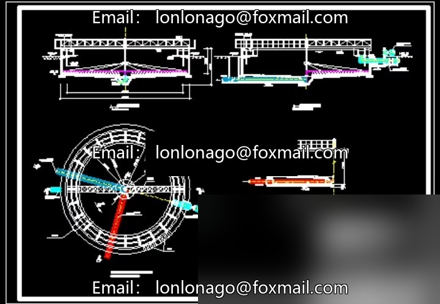
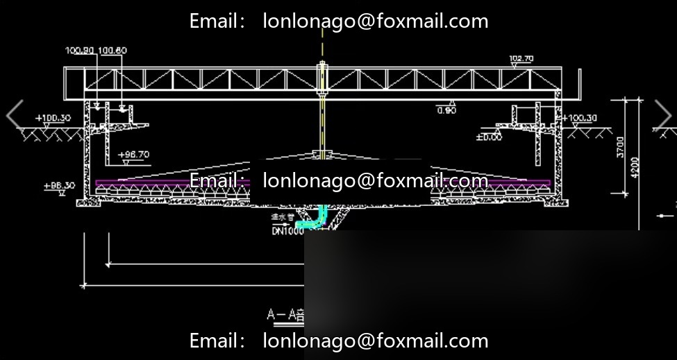
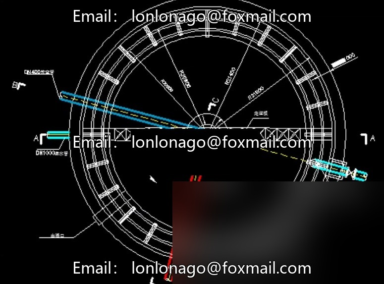
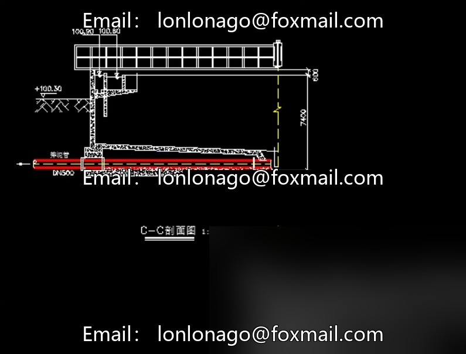
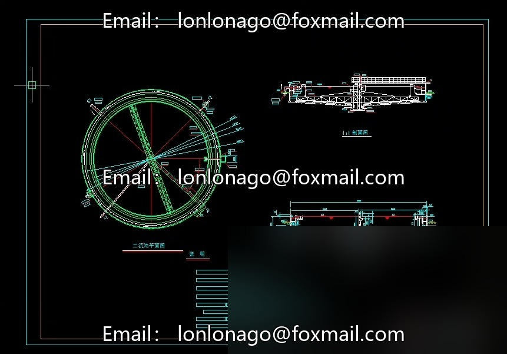
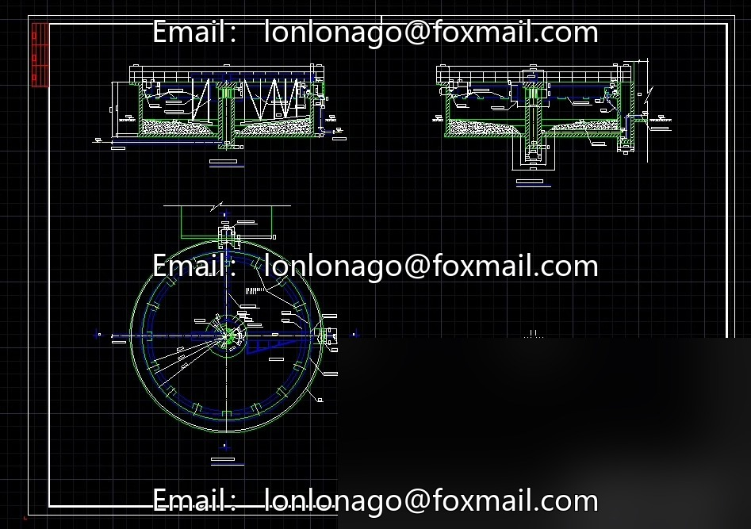

# Flow recirculating settling tank design; flow recirculating settling tank design drawing; flow recirculating settling tank profile and cross-section drawing

## Body

Flow recirculating settling tank design; flow recirculating settling tank design drawing; flow recirculating settling tank profile and cross-section drawing
2. Secondary Settling Tank Design 2. Secondary Settling Tank Design Drawing 2. Secondary Settling Tank Plan Section Diagram  5

The design focuses on a radar-flow sedimentation tank with design diagrams and flat cross-sections, including designs for the second sedimentation tank, its design diagrams and flat profiles.

<!-- AI_ENRICHED -->

## Images

## Payment

Here is a pay link on Stripe ( https://buy.stripe.com/3cs8yP7sY87d0vu9AB ). Please contact me lonlonago@foxmail.com after funding $89, and I will send you a complete data files , thank you!

